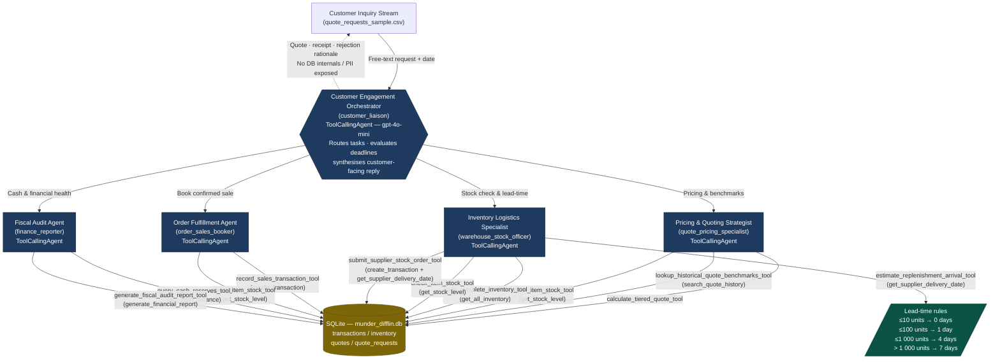

# Agent Workflow Diagram — The Beaver's Choice Paper Company

## Architecture Overview (Mermaid)

---

## Agent Responsibilities (Non-Overlapping)

| Agent | Identifier | Owns | Does NOT |
|---|---|---|---|
| **Customer Engagement Orchestrator** | `customer_liaison` | Interprets inbound requests; sequences worker delegation; composes complete, rationale-rich customer responses; enforces data-privacy guardrails | Access the database directly; price line items; write transactions |
| **Inventory Logistics Specialist** | `warehouse_stock_officer` | Warehouse stock snapshots; supplier lead-time calculations; supplier purchase order placement | Quote prices; write sales records; produce financial reports |
| **Pricing & Quoting Strategist** | `quote_pricing_specialist` | Tiered discount pricing (10% for >500 units, 15% for >2 000 units); historical quote benchmarking | Write transactions; check cash balances |
| **Order Fulfillment Agent** | `order_sales_booker` | Final stock verification at booking time; writing `sales` entries in the transaction ledger | Generate prices; check cash; produce financial reports |
| **Fiscal Audit Agent** | `finance_reporter` | Net cash balance queries; full financial health reports (inventory valuation, top sellers) | Modify transactions; quote or fulfil orders |

---

## Tool → Starter Helper Mapping

| Tool Function | Starter Helper(s) Used | Purpose |
|---|---|---|
| `audit_complete_inventory_tool` | `get_all_inventory` | Returns all items with positive net stock as of a date |
| `check_item_stock_tool` | `get_stock_level` | Returns net stock for a single named item |
| `estimate_replenishment_arrival_tool` | `get_supplier_delivery_date` | Projects supplier delivery date from order date + quantity |
| `submit_supplier_stock_order_tool` | `create_transaction` + `get_supplier_delivery_date` | Records a `stock_orders` transaction and returns projected delivery date |
| `calculate_tiered_quote_tool` | `get_stock_level` + `paper_supplies` catalogue | Computes discounted unit price and sub-total; flags stock status |
| `lookup_historical_quote_benchmarks_tool` | `search_quote_history` | Retrieves matching past quotes by keyword |
| `record_sales_transaction_tool` | `create_transaction` | Records a `sales` transaction in the ledger |
| `query_cash_reserves_tool` | `get_cash_balance` | Returns net cash balance as of a date |
| `generate_fiscal_audit_report_tool` | `generate_financial_report` | Returns cash, inventory valuation, total assets, and top-5 sellers |

---

## Data Flow (Step-by-Step)

1. `run_test_scenarios()` reads `quote_requests_sample.csv`, parses `request_date`, and sorts chronologically.
2. Each row's `request` text is appended with `(Date of request: YYYY-MM-DD)` and passed to `call_multi_agent_system()`.
3. The orchestrator (`customer_liaison`) receives the full text and delegates:
   - → `quote_pricing_specialist`: computes per-line-item pricing and discount tier
   - → `warehouse_stock_officer`: audits warehouse stock and projects supplier delivery dates
   - Feasibility check: if customer deadline < supplier arrival date **and** item is out of stock → order is **rejected** with a clear explanation
   - → `warehouse_stock_officer` (if feasible): places supplier purchase orders for deficient items
   - → `order_sales_booker`: writes confirmed `sales` transactions
   - → `finance_reporter`: performs a post-transaction financial health audit
4. The orchestrator synthesises a single customer-facing reply: itemised totals, discount rationale, delivery schedule.
5. The driver loop records `{request_id, request_date, cash_balance, inventory_value, response}` and writes `test_results.csv`.
